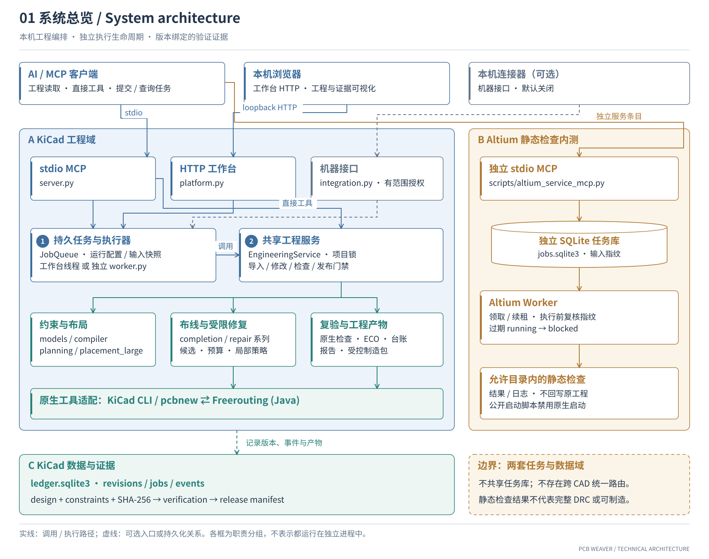

# PCB Weaver

面向 PCB 工程的本机 MCP 与工作台：以 KiCad 为主链路，另提供独立的 Altium 静态检查内测服务。

> [!IMPORTANT]
> 项目处于开发者内测阶段。**KiCad 的样例验收不等于任意 PCB 都能自动布通；Altium 服务目前不能自动布线或回写 PCB。** 软件检查也不能替代工程师审查、打样与制造签核。

## 能力概览

| 入口 | 已实现 | 尚未覆盖 |
| --- | --- | --- |
| **KiCad 主 MCP** | 工程导入、约束布局、布线编排、原生复验、ECO、受门禁保护的制造包 | 任意复杂板的全自动完成；硬件可靠性和量产签核 |
| **Altium 内测 MCP** | 允许目录内的静态工程检查、持久任务、断线续查 | 自动布线、PCB 回写、完整 DRC、制造放行 |

## 为什么做

让 AI 参与 PCB 设计，需要让它读取真实工程、调用本机工具，并把修改结果交回设计软件检查。PCB Weaver 将这些操作组织成有版本、有任务记录、有原生证据的工程流程。

输入是**已有原理图、网络和封装的 KiCad 工程，以及结构化约束**。项目可以用于梳理工程信息、比较受约束的布局候选、提交布线与有限修复任务、检查修改结果和追踪版本变化。

## 系统架构

[](docs/assets/architecture/system-overview.svg)

**图 1｜系统分层与工程域边界。** AI 客户端通过 MCP 调用工具；工作台提供本机 HTTP 入口。持久任务由工作台线程或独立 Worker 执行，KiCad 工程服务管理约束、版本和发布门禁。Altium 使用自己的 MCP、任务库与 Worker，默认仅运行静态检查。点击图片可查看矢量原图。

### KiCad 主链路如何工作

1. **导入工程**：复制工程文件与约束，记录文件哈希，建立版本快照。
2. **计算布局**：根据固定器件、区域、邻近和间距等约束生成候选，应用可行候选后创建子版本。
3. **调用布线工具**：KiCad/pcbnew 导出 DSN，Freerouting 生成 SES，再回导为待验证版本。
4. **原生复验**：运行对应版本的 ERC/DRC、网表一致性与几何等检查，保存具体失败原因和证据。
5. **显式发布**：请求制造包时重新检查，再导出真实产物、记录清单与归档哈希。

布局候选可行、布线回导成功、作业完成和制造门禁通过是不同结论。完整的[技术架构](docs/ARCHITECTURE.zh-CN.md)包含五张图，进一步说明模块分工、有限修复、版本证据、执行模型和 Altium 边界。

## 快速开始

**KiCad 主链路**（Windows PowerShell）：

```powershell
./Setup.ps1
./Start-Platform.ps1
```

需先准备 Python 3.11+。工作台默认在 `http://127.0.0.1:8765`；端口占用时运行 `./Start-Platform.ps1 -Port 8766`。`Setup.ps1` 安装项目 Python 依赖并生成本机 `.mcp.json`；原生路由仍需另行安装 KiCad、Java 和 Freerouting，并核对 `toolchain.unified.json` 的 WSL 与工具路径配置。

将 `.mcp.json` 中完整的 `pcb-weaver` 条目按客户端要求导入，启用并重载。工作台默认承载队列执行；也可以运行 `./Start-Worker.ps1` 单独执行任务。**仅连接 MCP 不会启动队列 Worker**。工作台 URL 不是 MCP stdio 地址。

完整步骤与故障排查见[部署与 MCP 接入](docs/GETTING-STARTED.zh-CN.md)。可用 `./Run-Demo.ps1` 运行小板回归，`-Route` 才会尝试完整工具链。

**Altium 静态检查内测**（单独配置）：

```powershell
./Setup-Altium-Service.ps1 -ProjectRoot 'D:\PCB-Projects'
./Start-Altium-Service.ps1
```

把生成的 `altium-local-developer-beta` 条目添加到支持 stdio 的 MCP 客户端。先调用 `altium_service_status`，再提交 `altium_submit_inspection`；任务结果用 `altium_get_job` 查询。完整安装及限制见[内测配置](docs/GITHUB-RELEASE.zh-CN.md)。

## 文档导航

| 想了解 | 文档 |
| --- | --- |
| 从安装到 MCP 调用与后台执行 | [部署与 MCP 接入](docs/GETTING-STARTED.zh-CN.md) |
| 模块、任务、版本和工程门禁 | [技术架构](docs/ARCHITECTURE.zh-CN.md) |
| Altium 工具与故障恢复 | [Altium 内测服务](docs/ALTIUM-SERVICE-BETA.zh-CN.md) |
| 本机机器接口与企业接入边界 | [集成说明](docs/INTEGRATION.zh-CN.md) |
| KiCad 实测范围与历史记录 | [固定布局验收](docs/FIXED-WHOLEBOARD-VALIDATION.md)、[系统验证](docs/SYSTEM_VALIDATION.zh-CN.md) |
| 完整文档目录与图源 | [文档导航](docs/README.md)、[架构图维护](docs/assets/architecture/README.md) |

公开仓库不包含本机工程、配置和大体积原生验收存档；克隆后必须在自己的工具链上重新验证。主项目使用 [Apache-2.0](LICENSE)，示例与第三方材料按[各自许可](THIRD_PARTY.md)使用。
