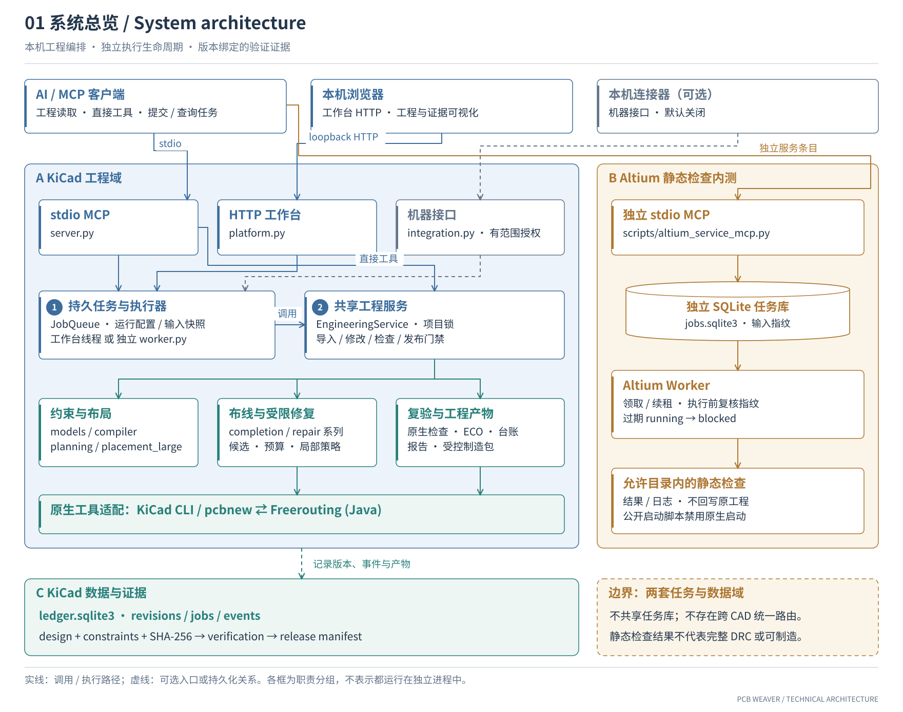
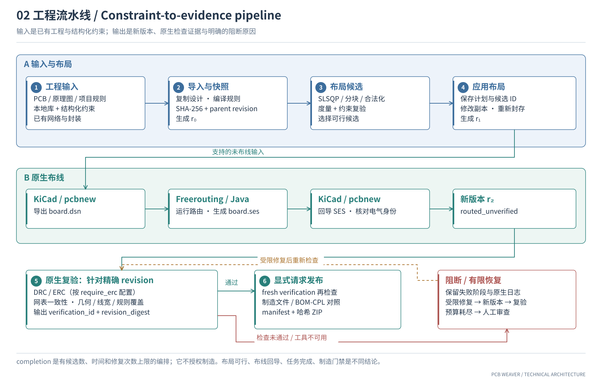
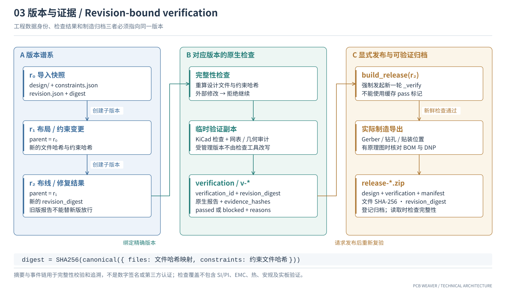
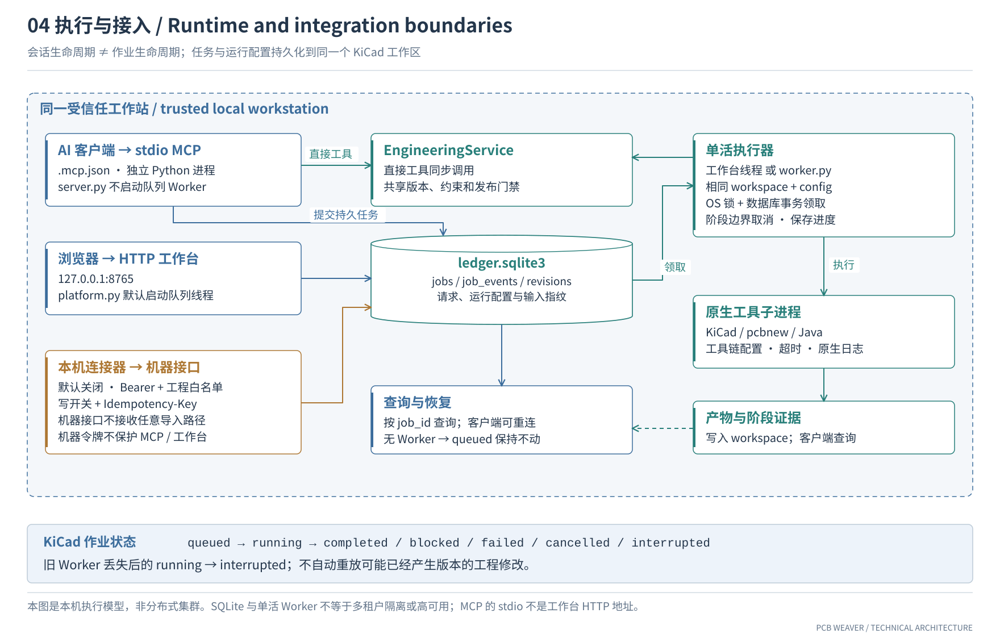
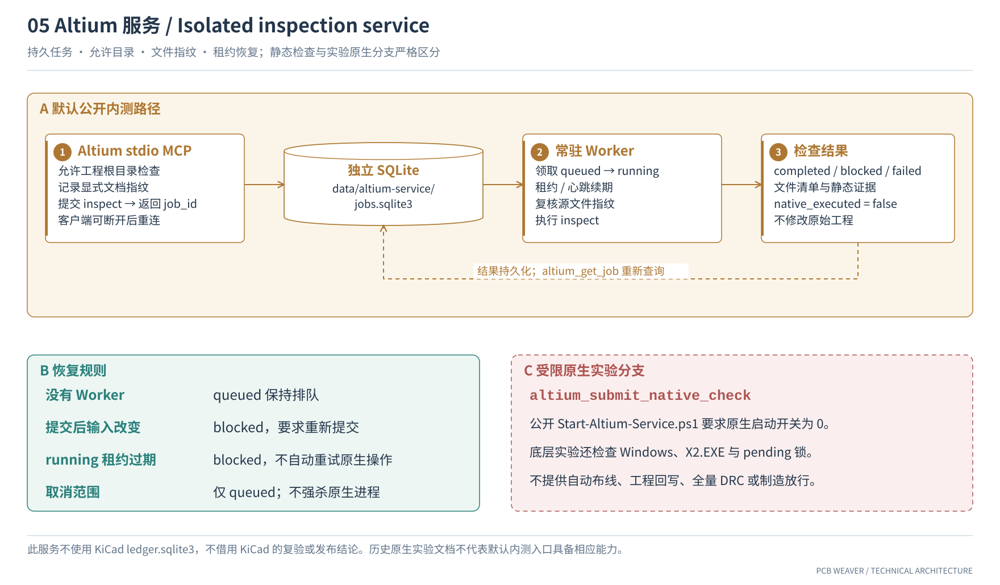

# PCB Weaver 技术架构

[首页](../README.md) · [文档导航](README.md) · [部署与 MCP 接入](GETTING-STARTED.zh-CN.md) · [机器接口](INTEGRATION.zh-CN.md) · [Altium 服务](ALTIUM-SERVICE-BETA.zh-CN.md)

PCB Weaver 把已有 PCB 工程、结构化约束、本机设计工具和可追溯的检查结果连接起来。AI 客户端通过 MCP 读取工程和调用工具；项目负责工程版本、任务编排、约束计算、原生工具适配以及结果验证。浏览器工作台提供同一 KiCad 工程域的查看与操作入口。

本文描述仓库当前实现。**KiCad 是布局、布线、复验与受控制造导出的主链路；Altium 是使用独立任务库的静态检查内测服务。** 两者没有共享自动布线引擎，也不互相继承验证结论。图中的框表示职责，不一定是独立进程。

## 1. 系统总览

[](assets/architecture/system-overview.svg)

**图 1｜系统分层与工程域边界。** 蓝色表示 KiCad 接口与编排，绿色表示工程计算、原生工具与证据，棕色表示独立 Altium 服务。实线是调用或执行路径，虚线是可选入口或持久化关系。点击图片可查看矢量原图；生成方式见[图件说明](assets/architecture/README.md)。

| 职责 | 主要实现 | 输入与输出 |
| --- | --- | --- |
| 接入与交互 | [`server.py`](../src/pcb_weaver/server.py)、[`platform.py`](../src/pcb_weaver/platform.py)、[`cli.py`](../src/pcb_weaver/cli.py) | MCP stdio、本机 HTTP 与 CLI；返回工程、任务、检查与产物信息 |
| 工程服务与持久任务 | [`service.py`](../src/pcb_weaver/service.py)、[`jobs.py`](../src/pcb_weaver/jobs.py)、[`worker.py`](../src/pcb_weaver/worker.py) | 精确 revision、操作参数与运行配置；生成子版本、阶段记录或阻断原因 |
| 约束、布局与修复 | [`models.py`](../src/pcb_weaver/models.py)、[`compiler.py`](../src/pcb_weaver/compiler.py)、[`planning.py`](../src/pcb_weaver/planning.py)、[`completion.py`](../src/pcb_weaver/completion.py) | 结构化意图与板级几何；输出有范围、有预算的候选与工程修改 |
| 原生工具适配 | [`toolchain.py`](../src/pcb_weaver/toolchain.py)、[`native_bridge.py`](../src/pcb_weaver/native_bridge.py) | KiCad CLI / pcbnew、Freerouting / Java；输出 DSN、SES、ERC/DRC、制造文件与日志 |
| 存储、证据与交换 | [`storage.py`](../src/pcb_weaver/storage.py)、[`catalog.py`](../src/pcb_weaver/catalog.py)、[`inventory.py`](../src/pcb_weaver/inventory.py)、[`exchange.py`](../src/pcb_weaver/exchange.py)、[`report.py`](../src/pcb_weaver/report.py) | SQLite 账本、版本目录、哈希清单、台账与审查报告 |

MCP 不是模型推理引擎。AI 的会话与推理位于客户端一侧，项目内的布局计算、规则编译、任务领取和发布判断由具体程序完成。工作台前端见 [`src/pcb_weaver/web`](../src/pcb_weaver/web)，可选机器接口见 [`integration.py`](../src/pcb_weaver/integration.py)。

## 2. 从约束到原生证据

[](assets/architecture/engineering-pipeline.svg)

**图 2｜KiCad 工程流水线与失败反馈。** 上排处理输入与布局，中排执行原生布线，下排区分复验、受限恢复和显式发布。`r₀ → r₁ → r₂` 表示创建子版本，不是直接覆盖用户原工程。

### 输入、约束与规则编译

输入是已有 `.kicad_pcb` 及其项目文件、原理图、项目声明的本地库与结构化约束。导入会复制支持的工程文件，检查层次原理图和库引用，再封存文件哈希。全局库、外部 3D 模型和整台机器的工具环境不因此被完整快照，具体范围记录于 `dependency_scope`。

[`Constraints`](../src/pcb_weaver/models.py) 区分板级要求、固定器件、区域、邻近关系、网络线宽、制造下限和发布设置。[`compiler.py`](../src/pcb_weaver/compiler.py) 将支持的规则落实到 KiCad 工程，并审计既有规则与原生报告。Schema 能表达某参数，不代表已经完成该参数涉及的全部电气或制造验证。

### 布局计算

[`planning.py`](../src/pcb_weaver/planning.py) 使用焊盘级几何估算半周长线长（HPWL），结合固定器件、板边、区域、邻近与碰撞约束生成候选。局部优化使用 SciPy SLSQP；[`placement_large.py`](../src/pcb_weaver/placement_large.py) 提供分块求解与最小位移合法化。计划保存候选、可行性、违反项和度量，应用时再次检查并创建子版本。

**HPWL 是布局线长估计，不能当成实际布线长度；候选 `feasible` 也不是电气或制造签核。** 已有走线的板不能直接套用未布线板的整体布局调整路径。

### 原生布线与有界恢复

主布线链路为 `KiCad/pcbnew 导出 DSN → Freerouting 生成 SES → KiCad/pcbnew 回导`。[`Toolchain`](../src/pcb_weaver/toolchain.py) 管理命令、执行环境、超时和日志；[`EngineeringService.route_revision`](../src/pcb_weaver/service.py) 核对回导前后的器件位置与网络身份，成功后创建 `routed_unverified` 版本。

[`completion.py`](../src/pcb_weaver/completion.py) 编排有限数量的布局候选、布线尝试与修复周期，区分布局不可行、路由超时、输入电气问题、规则冲突及未连接等失败。它不是无上限自主循环，`complete` 操作也不能授权制造发布。

局部修复由 [`repair.py`](../src/pcb_weaver/repair.py)、[`auto_repair.py`](../src/pcb_weaver/auto_repair.py)、[`reference_repair.py`](../src/pcb_weaver/reference_repair.py) 等负责。网络、区域、可移除对象和尝试预算受到约束；`grid_route.py`、`via_escape.py`、`joint_route.py`、`negotiated_reroute.py` 等实现特定受限策略，不构成任意 PCB 的通用自动布线承诺。修改后仍需重新检查。

### 原生复验与受控制造导出

原生复验在完整工程的临时副本上执行，包括 KiCad DRC、按 `require_erc` 配置要求检查 ERC、原理图与 PCB 网络/器件一致性、声明几何约束、持久化线宽下限及规则和几何覆盖。必要报告缺失、工具不可用、输入被修改或检查未通过都会生成阻断原因。

`build_release` 必须重新调用 `_verify`。新鲜检查通过后才导出真实制造文件，核对支持范围内的 BOM / 贴装位置关系，保存清单和哈希归档。它不提交板厂订单，也不替代 SI/PI、EMC、热、安规、装配审查和实板验证。

## 3. 版本、验证与产物身份

[](assets/architecture/revision-evidence.svg)

**图 3｜修改生成新身份，检查绑定该身份，发布重新取得证据。** 每个 revision 记录父版本、操作类型、设计文件哈希与约束哈希。`_verified` 重算受管理文件，拒绝在版本被外部修改后沿用旧身份。SHA-256 与事件链用于完整性校验和追溯，并不构成数字签名或第三方认证。

| 对象 | 保存的信息 | 使用约束 |
| --- | --- | --- |
| Revision | `id`、`parent`、`operation`、`files`、`constraints_hash`、`digest` | 导入、布局应用、约束更新和布线/修复创建新版本；修改副本而非原始输入 |
| Verification | `verification_id`、`revision_digest`、原生报告、`evidence_hashes`、`reasons` | 只说明对应版本与声明检查范围；旧报告不能为新版放行 |
| Job | 请求、运行配置/输入快照、阶段、事件、结果和取消状态 | 会话退出不删除任务；持久任务由 Worker 执行 |
| Release | `revision_digest`、新鲜检查、真实产物、`manifest.json`、归档哈希 | 读取依据登记记录和完整性检查 |
| Inventory / exchange | 版本绑定的器件、焊盘、网络和几何；JSON / CSV / ZIP | 交换包 `manufacturing_authorized=false`；台账不等于连通性签核 |

典型 KiCad 工作区结构如下，阶段文件随操作而变化：

```text
data/
├── ledger.sqlite3                 # 版本、事件、任务与阶段记录
├── jobs/<job_id>/                  # 任务阶段结果
└── projects/<project>/
    ├── revisions/<revision>/
    │   ├── design/                # 受管理工程副本
    │   ├── constraints.json
    │   ├── revision.json
    │   └── verification/<v-id>/    # 原生报告与结果
    └── releases/<release-id>/      # 设计、证据、产物与 manifest
```

[`eco.py`](../src/pcb_weaver/eco.py) 与版本比较接口分析几何、网络、器件和约束变更；[`inventory.py`](../src/pcb_weaver/inventory.py) 读取版本台账，缺乏来源的数据保持未知，不补造料号或制造结论。

## 4. 运行进程与接入边界

[](assets/architecture/runtime-integration.svg)

**图 4｜会话、任务与执行的生命周期分离。** MCP 同时提供直接工具和持久任务工具：前者在调用中执行，后者写入 `JobQueue`。MCP 不启动队列执行线程；工作台默认启动该线程，或由独立 `python -m pcb_weaver.worker` 执行。它们需指向相同工作区和工具链配置。

队列用数据库事务领取任务，并以操作系统锁保证单活执行。请求、运行配置和输入清单在提交时记录、执行时复核。取消在阶段边界处理；Worker 丢失后的遗留 `running` 转为 `interrupted`，不自动重放可能已经产生新版本的修改。无 Worker 时任务可以提交，但保留在 `queued`。

可选机器接口位于 `/api/integration/v1`，默认关闭，使用机器令牌、工程白名单、写开关和幂等键。**机器令牌并不保护 stdio MCP 或普通工作台接口。** 部署定位是同一受信任工作站上的本机服务，不具备公网多租户平台的身份、隔离和高可用能力。详见[部署与 MCP 接入](GETTING-STARTED.zh-CN.md)及[机器接口](INTEGRATION.zh-CN.md)。

## 5. Altium 独立服务

[](assets/architecture/altium-service.svg)

**图 5｜默认静态路径与受限原生实验分支。** [`altium_service_mcp.py`](../scripts/altium_service_mcp.py) 接收允许目录中的工程路径，服务记录显式文档指纹并持久化任务；[`altium_service_worker.py`](../scripts/altium_service_worker.py) 领取、续租，在执行前重新核对指纹。结果可在 MCP 断开后重新查询。

Altium 使用独立的 `data/altium-service/jobs.sqlite3`。输入变化或运行态租约过期会阻断；其 `running → blocked` 恢复语义不同于 KiCad 的 `running → interrupted`。公开启动脚本要求原生启动开关为 `0`，底层受限实验不能当成默认内测能力。该服务不提供自动布线、原工程回写、全量 DRC 或制造放行，详见[Altium 服务](ALTIUM-SERVICE-BETA.zh-CN.md)。

## 6. 状态与验收范围

| 状态或指标 | 可以得出的结论 | 不能据此推出 |
| --- | --- | --- |
| 布局 `feasible` | 支持范围内的布局约束审计通过 | 全局最优、布线必通、电气签核 |
| `routed_unverified` | 结果已回导并封存为版本 | 原生检查通过或可制造 |
| 作业 `completed` | 请求的操作执行完毕 | PCB 完整可制造 |
| 检查 `passed` | 对应版本通过此次声明的检查 | 未执行的信号、电源、热、EMC 或实板测试通过 |
| 制造归档 | 通过项目门禁并生成、登记实际文件 | 板厂、装配厂或工程师的最终签核 |

实测范围见[固定布局验收](FIXED-WHOLEBOARD-VALIDATION.md)、[系统验证](SYSTEM_VALIDATION.zh-CN.md)与[验证索引](README.md#验证与研究记录)。这些图描述实现结构，不是新增实验结果；历史样例通过率不能推广成任意 PCB 的成功率。
