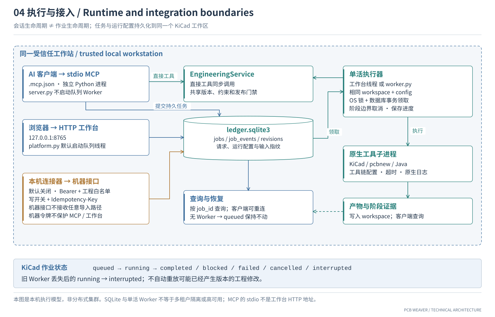

# 部署与 MCP 接入

[首页](../README.md) · [技术架构](ARCHITECTURE.zh-CN.md) · [机器接口](INTEGRATION.zh-CN.md) · [Altium 配置](GITHUB-RELEASE.zh-CN.md)

本页针对 KiCad 主链路。成功连接 MCP 说明接口可用，布线任务还需要运行中的执行器及有效的原生工具链。

[](assets/architecture/runtime-integration.svg)

**图｜进程与工作区关系。** 工作台默认启动队列线程，也可以单独启动 Worker；MCP 服务不启动队列 Worker。它们必须使用同一 `workspace` 和 `config`。

## 1. 准备环境

- Python 3.11 或更高版本。
- 按[工具链说明](../tools/README.md)安装 KiCad、Java 和 Freerouting，核对实际版本与所选配置。
- 默认 [`toolchain.unified.json`](../toolchain.unified.json) 使用 WSL。检查 `wsl_distro`、KiCad Python、Java 与 JAR 路径。
- 支持 MCP stdio 的客户端，以及用于查看工作台的浏览器。

在 Windows PowerShell 中执行：

```powershell
git clone https://github.com/chenzehaoo/pcb-weaver.git
cd pcb-weaver
./Setup.ps1
```

`Setup.ps1` 创建 `.venv`，安装 Python 依赖，生成 `.mcp.json` 并运行工具链诊断。它不安装 KiCad、Java 或 Freerouting。使用其他配置时，安装和后续启动都要传入相同的 `-Config` 文件。

## 2. 接入 MCP 客户端

将生成的 `.mcp.json` 中完整的 `pcb-weaver` 条目，按客户端要求导入或复制到 MCP 配置，再启用并重载。条目结构如下；这里的路径是示例，优先使用脚本生成的绝对路径。

```json
{
  "mcpServers": {
    "pcb-weaver": {
      "command": "D:\\pcb-weaver\\.venv\\Scripts\\python.exe",
      "args": ["-m", "pcb_weaver.server"],
      "env": {
        "PCB_WEAVER_WORKSPACE": "D:\\pcb-weaver\\data",
        "PCB_WEAVER_CONFIG": "D:\\pcb-weaver\\toolchain.unified.json"
      }
    }
  }
}
```

生成器只写仓库内的 `.mcp.json`，不修改客户端全局设置。移动项目后需重新生成。本机工作台的 HTTP 地址不能填作 MCP stdio 服务地址。

## 3. 启动执行器

带工作台的运行方式：

```powershell
./Start-Platform.ps1
# 端口冲突时：./Start-Platform.ps1 -Port 8766
```

浏览器访问 `http://127.0.0.1:8765`。工作台默认启动队列线程，需保持进程运行。只需要后台执行时，可改用：

```powershell
./Start-Worker.ps1
```

这两种方式都能承载队列执行，无须为同一工作区同时启动两套执行器；KiCad 使用单活执行锁。MCP 会话可以断开后重连查询任务；执行器未启动时任务保留在 `queued`。

## 4. 验证一次完整接入

1. 调用 `environment_status`，检查本机工具链。
2. 用 `import_pcb_project` 导入已有工程与约束，保留返回的 project / revision。
3. 用 `inspect_pcb_revision` 或 `inspect_pcb_inventory` 确认读取的是预期版本。
4. 在支持范围内调用布局工具，或用 `submit_engineering_job` 提交持久任务，通过 `get_engineering_job` 查询。
5. 查看原生报告及对应 revision；布线回导与任务完成均不自动代表通过制造门禁。

可先运行 `./Run-Demo.ps1` 做小板回归，`-Route` 才尝试完整原生链路。这不替代自己工程的验证。

## 5. 常见现象

| 现象 | 优先检查 |
| --- | --- |
| MCP 可连接，任务一直 `queued` | 工作台 / Worker 是否运行，是否指向相同工作区 |
| 工具链诊断失败 | Windows / WSL 环境、Java/JAR 版本、KiCad CLI/Python 路径 |
| 作业 `blocked` | 具体阶段的原因与原生日志 |
| 作业 `interrupted` | 前一 Worker 是否退出；核对已产生的版本与证据后再决定是否重提 |
| 版本完整性检查失败 | 是否手动改了受管理副本；变化后的文件应重新导入为新版本 |
| Altium 服务无法执行 KiCad 任务 | 两者是独立 MCP、任务库与执行器，应分别配置 |
